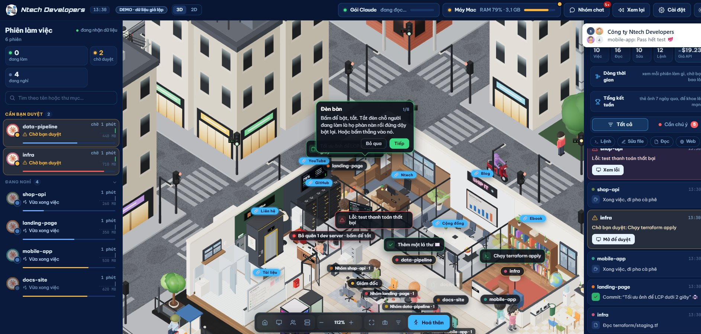
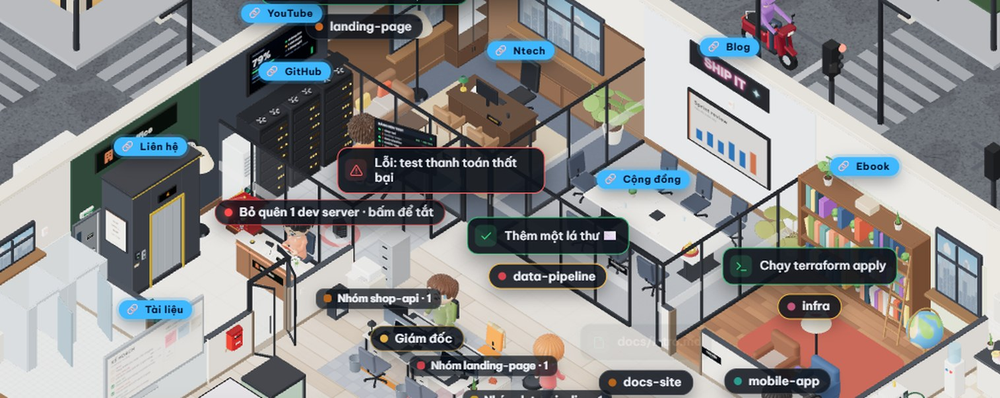

# Ntech.Illustration.OPC.Agent

An isometric 3D office where every AI coding session is a colleague at a desk. Sessions arrive, pick up work, run
commands, edit files, wait for approval, take coffee breaks and go home. A live activity feed, a timeline, replay,
machine health and a group chat sit around the office.

It runs as a static **demo** with sample data and no server, in the Ntech Developers brand and colours. It is the
showcase behind the "Office Solutions" zone of [ntechdevelopers.com](https://ntechdevelopers.com).

**Live demo:** [https://ntechdevelopers.com/showcase-office-3d/](https://ntechdevelopers.com/showcase-office-3d)



The office also shows the Ntech Developers ecosystem:

- **🔗 pins on the furniture.** The bookshelf opens the ebook library, the whiteboard the docs and the UML tool, the
  server racks GitHub, the TV YouTube, the SHIP IT neon the blog, the meeting room the community channels, the rocket
  the 3D showcases, and so on. A click on a pin, or on the piece of furniture itself, opens a card of links.
- **The group chat.** The director pins a welcome with the main links. From then on, people in the office share
  blog posts, community channels, the ebook library and tools every minute or two, as clickable links.



All sites, channels and posts live in one file, `src/ntech/ecosystem.ts`.

## Run it

Requires Node.js 20.19 or later.

```bash
npm install
npm run dev        # http://localhost:5173
npm run build      # static site in dist/
npm run preview    # serve dist/
```

To serve the site from a sub-path, set `BASE_PATH` at build time, for example
`BASE_PATH=/Ntech.Illustration.OPC.Agent/ npm run build`. The GitHub Pages workflow in
`.github/workflows/pages.yml` does this on every push to `main`. Before its first run, enable Pages in
**Settings → Pages → Source: GitHub Actions**.

### URL options

| Parameter | Values | Effect |
| --- | --- | --- |
| `lang` | `vi` (default), `en`, `th` | Interface language. Settings → Language switches it too. |
| `brand` | any text | Name shown next to the logo (default `Ntech Developers`). |
| `layout` | `pro` (default), `cozy`, `hq` | Floor plan: company floor, one open room, or headquarters with a wing of departments. |
| `at` | `12:10` or an ISO date-time | Pretends it is that time (lunch, evening, seasonal decorations). |
| `season` | `halloween`, `noel`, `tet`, `none` | Forces a seasonal decoration. |

## How it is put together

| Path | What it is |
| --- | --- |
| `src/vendor/` | The office itself: `office/` (the 3D world, people and UI logic, plain JavaScript on three.js), `components/` (the page markup, `App.tsx`), `i18n/`, `shared/`, `styles/`. |
| `src/main.tsx`, `src/env.ts` | Entry: sets the language, brand and demo platform, then renders the office. |
| `src/brand.ts` | The Ntech Developers mark and name in the top bar. |
| `src/office.css` | The office stylesheets in their cascade order. |
| `src/ntech/ecosystem.ts` | The Ntech ecosystem: sites, channels, featured blog posts, which furniture carries which links, and the chat lines (Vietnamese and English). |
| `src/ntech/runtime.ts`, `src/ntech/ntech.css` | The 🔗 pins, the link card and the chat feed. |
| `src/ntech-theme.css` | The Ntech look: deep navy panels and the sky-blue accent, applied on top of the office's design tokens. |
| `public/assets/` | Static assets: shop logos, the car kit, floor-plan thumbnails, qrcode.js. |
| `vite.config.ts` | Vite build. It also supplies the build variables the office reads (`process.env.NEXT_PUBLIC_*`). |

Built as a Vite + React 19 static site on three.js 0.186.

### Where the Ntech features hook in

- `components/office/TopBar.tsx`: the Ntech Developers brand (`src/brand.ts`).
- `office/interact/props.js`: calls `ntechPins` once the furniture is built, and `ntechPropClicked` when a piece is clicked.
- `office/ui/group-chat.js`: starts `ntechChat` with the demo chat engine.
- `office/ui/group-chat-view.js`: messages tagged `ntech` are rendered as Markdown, so their links are clickable.

## Credits and third-party material

- **Fonts**: Be Vietnam Pro, JetBrains Mono, IBM Plex Sans Thai Looped (SIL Open Font License 1.1, from Google Fonts), plus Orbitron for the brand name (loaded from Google Fonts).
- **Cars**: Kenney's [Car Kit](https://kenney.nl/assets/car-kit) (CC0 1.0), see `public/assets/vehicles/README.md`.
- **Shop and ride-hailing logos**: from Wikimedia Commons (PD-textlogo) and Simple Icons (CC0), see `public/assets/brands/README.md`. They are still trademarks of their owners. This project is not affiliated with or endorsed by any of them, and the logos appear only as part of a street scene.
- **qrcode.js**: MIT.
- **Ntech Developers** name and logo: belong to NtechDevelopers. The MIT license covers the code, not the right to present another project as Ntech Developers.
